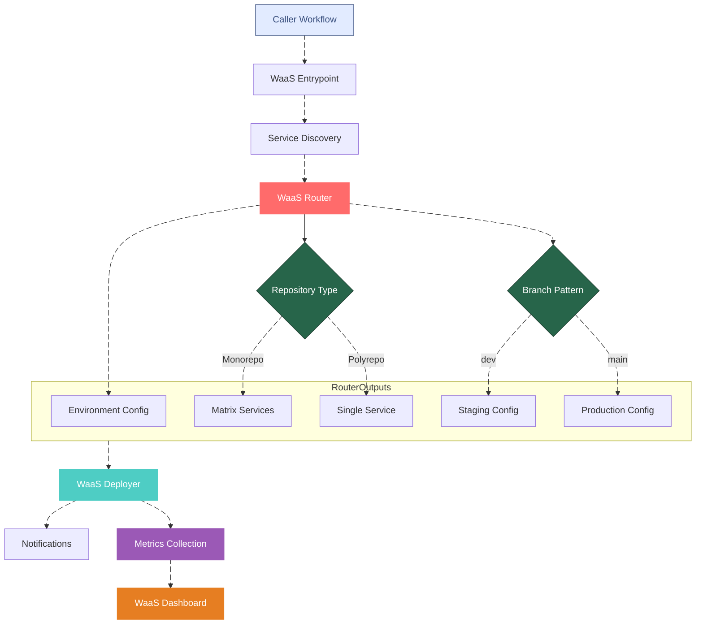
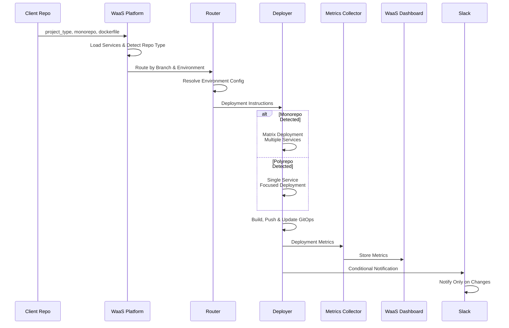

# WaaS architecture

How a deployment moves through WaaS, from the calling workflow to the GitOps repository, Slack and the dashboard. The [README](../../../README.md) covers how to use it.

## High-level flow

A service repository calls the reusable workflow, [`waas.yml`](../waas.yml), its entry point. Each stage after it is a composite action:

| Stage | Action | What it does |
|---|---|---|
| Service discovery | [`load-services-matrix`](../../../workflow-templates/workload/utils/load-services-matrix) | Reads the services file, the repository's own or its entries in the shared catalog, and decides whether the repository deploys one service or several, and which deploy to each environment. The decision is made by the `waas` CLI. |
| Router | [`router`](../../../workflow-templates/workload/waas/router) | Finds the environment the branch deploys to, from the services file's `metadata.environments` (by default `dev` to staging and `main` to production), and gives the deployer that environment's name, domain and build configuration, and the services to deploy: a matrix for a monorepo, one service for a polyrepo. |
| Deployer | [`deployer`](../../../workflow-templates/workload/waas/deployer) | Runs once per service, in parallel. It promotes or builds the image, publishes it, and writes its tag to the service's values in the GitOps repository. |
| Notifications | [`slack-notify`](../../../workflow-templates/shared/slack-notify) | Posts the result to Slack when a deployment ran; skipped and unchanged services send nothing. |
| Metrics collection | [`collect-metrics`](../../../workflow-templates/workload/utils/collect-metrics) | Sends each deployment's record to the WaaS dashboard. |

## Detailed flow

1. The caller passes its project type and repository settings; the services file supplies the rest per service.
2. WaaS loads the services and decides whether the repository is a monorepo or a polyrepo.
3. The router resolves the environment from the branch; a branch no environment takes deploys nothing.
4. The deployer runs per service: a matrix of services for a monorepo, a single service for a polyrepo.
5. For each service it builds and pushes the image, or promotes the one staging already built, and updates the GitOps repository. A service whose values already hold the tag the run would write is skipped.
6. The deployment's record goes to the dashboard, and Slack is notified only when something was deployed.

## The WaaS dashboard

The dashboard records every deployment WaaS runs and shows them by environment, service, status and time.

`collect-metrics` sends each deployment to `POST <waas_api_url>/api/deployments` with a workflow API key (`X-API-Key`). The record carries the environment, service, service type, status, duration, commit, image tag, and the workflow run it came from. `GET /api/deployments` and `/api/insights` serve the history and its statistics.
